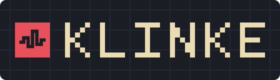
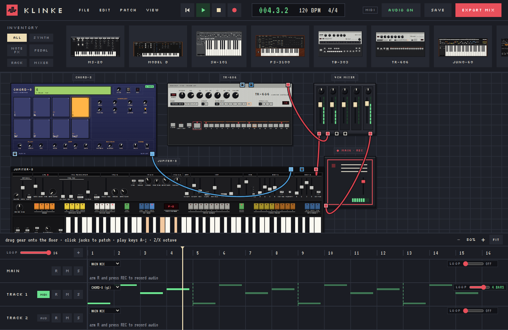

<p align="center"></p>

<p align="center"></p>

<p align="center">
  A patch bay studio in the browser · Built with Angular and the Web Audio API
</p>

KLINKE is a modular music studio laid out like a floor of hardware. Drag synths, a sampler,
pedals and rack effects onto the floor, patch them together with cables, play them from the
computer keyboard or a MIDI controller, and record the result onto a 16-bar timeline. Every
sound is generated live in the browser; there is no server.

**Live demo:** https://jonobail.github.io/klinke/

## Features

- **Patch anything into anything.** Each piece of gear has real IN and OUT jacks; signal flows
  only where cables go, and feedback loops are refused.
- **Synths modelled on their service manuals and schematics,** monophonic and polyphonic, each
  with its original voice architecture, panel layout and quirks.
- **NOTE cables** carry notes between gear: chord generators, per-note expression and a
  physically modelled choir.
- **SP-1200 sampling drum machine** that samples whatever you patch into it, driven from its
  front-panel keys and LCD like the original.
- **Effects:** overdrive, delay, reverb and filter pedals, the MF-104 analog delay, and twelve
  rack processors (H949, Delta-T, Model 200, PCM-70, PCM-80, DPS-D7 / M7 / R7 / V55 / V77,
  E1010, REV5).
- **MIDI tracks** with live quantised recording (overdub or replace, with velocity), a piano roll
  with step entry, selection, copy / paste and a velocity lane, plus quantize and swing.
- **MIDI clock** out to other gear, or follow an external clock (start, stop, song position, tempo).
- **Loops** for the whole song and for each track (1–16 bars), so a one-bar beat can repeat under
  a longer part.
- **Audio tracks** that record the main mix or any single piece of gear, with waveforms and
  playback scheduled on the audio clock.
- **EXPORT MIX** bounces the song to a WAV file.
- **Works on phones and tablets:** pinch and double-tap zoom, touch-playable keys, iOS audio
  unlock.
- **Saves locally:** patches and songs in localStorage, recorded audio in IndexedDB, and patches
  export / import as JSON.

## Quick start

1. Open the [live demo](https://jonobail.github.io/klinke/). The demo rig is already patched:
   a chord generator plays a polysynth over a NOTE cable, and a drum machine joins it in the
   mixer feeding **MAIN • REC**.
2. Click anywhere to start audio, then play **A S D F G H J K L** (white keys) and
   **W E T Y U O P** (black keys); **Z / X** change octave.
3. Click a synth to give it the keyboard (marked **⌨ KEYS**); press **RUN/STOP** on the drum
   machine to start its beat.
4. Arm a track with **R**, press **REC**, play, then press **EXPORT MIX** to save a WAV.

## Using KLINKE

### Patching

| Action | How |
|---|---|
| Add gear | Drag a tile from **INVENTORY** onto the floor, or click it |
| Connect | Click an OUT jack (red ring), then an IN jack (white ring) |
| Disconnect | Click the cable |
| Move / remove | Drag a box by its body; select it and press **Delete** (or **×**) |
| Adjust controls | Drag knobs and faders vertically, scroll over them, or focus and use the arrow keys |
| Bypass a pedal | Click its footswitch |

Only what reaches **MAIN • REC** is heard. A **MULT** splits one signal to several inputs.

Blue DIN-style jacks carry notes, not sound: patch note gear into an instrument's NOTE IN with NOTE
cables and play it from the keys. Every instrument has a NOTE IN (play it from a cable) and a NOTE OUT (passes on whatever it plays),
so one keyboard or chord can drive several synths at once.

### Playing

The computer keyboard plays one instrument at a time. A MIDI controller works in Chrome and Edge
over HTTPS or localhost, including pitch bend and the mod wheel. You can also click or slide
across any on-screen keyboard.

### Recording

- **Transport:** **Space** plays and stops; **STOP** twice returns to the top; click the ruler to
  move the playhead.
- **MIDI tracks:** switch a track to **MIDI** and pick its instrument. Arm it (**R**) and press
  **REC** to record notes, quantised to the track's grid (default 1/16). Click the lane to open
  the piano roll: click to add a note, drag to move, drag the right edge to resize,
  double-click or **Delete** to remove. Shift-click or shift-drag selects; the arrows transpose
  and nudge; **Ctrl+C / V / D** copy, paste and duplicate; drag the VEL bars for velocity.
  **QUANTIZE** snaps the selection (or the track), **SWING** delays the off-beats, and
  **OVERDUB / REPLACE** sets how recording treats notes already there. **STEP** writes each note
  or chord you play at the cursor and moves on a step (REST, TIE, BACK).
- **MIDI clock:** click the **MIDI** badge to send clock to your other gear (**CLOCK OUT**) or to
  follow theirs (**SYNC EXT**: their start, stop, song position and tempo).
- **Audio tracks:** choose what the track records: **MAIN MIX** or one piece of gear's OUT. Arm
  it and press **REC**; the take appears with its waveform and plays back in time with the song.
  Mute (**M**) and solo (**S**) apply. **✕** deletes a track's takes. Wrapping round the loop or
  moving the playhead while recording starts a new take.
- **Loops:** the **LOOP** slider above the tracks sets the song loop (1, 2, 4, 8 or 16 bars);
  bars past it are shaded and never play. Each track also has its own **LOOP** slider: set it to
  1–8 bars and the track repeats its first bars across the song (dimmed copies show the repeats).
  A looping MIDI track records each pass into its loop; a looping audio track starts a new take
  each time round.
- **EXPORT MIX** (or **FILE → Export mix**) plays the song once from the top in real time,
  through the last note or take plus a bar for tails (exactly one pass when the song loop is
  shorter than 16 bars), and downloads `klinke-mix.wav`. Click
  again to cancel.
- **SAVE** (or **Ctrl+S**) keeps the patch and song in this browser. Recorded audio is saved
  as soon as each take ends.

### Instrument notes

Each piece of gear is documented in [docs/devices/](docs/devices/).

## Run locally

**Requirements:** Node.js 24 or newer.

```sh
git clone https://github.com/jonobail/klinke.git
cd klinke
npm install
npm start               # http://localhost:4200
npm test                # unit tests for src/app/core (node --test)
npm run build           # production build in dist/klinke
```

`npm run start:tailnet` serves on `0.0.0.0:4200` so other devices on a Tailscale network can
connect. Web MIDI needs HTTPS or localhost, so MIDI controllers only work locally or on the
hosted version.

## Deployment

Every push to `master` runs `.github/workflows/pages.yml`, which runs the unit tests, builds with
`--base-href /klinke/` and publishes to GitHub Pages. The app is fully static.

## Project layout

| Path | Contents |
|---|---|
| `src/app/core/` | Framework-free logic: gear catalogue, patch graph, transport, notes, WAV encoding |
| `src/app/audio/` | Web Audio engine: one unit per gear kind, graph sync, notes, meters, takes storage |
| `src/app/patch-store.ts` | Patch state, selection, cable patching, persistence |
| `src/app/transport.ts` | Song clock and tracks |
| `src/app/sequencer.ts` | MIDI track playback and recording |
| `src/app/recorder.ts` | Audio takes, playback and EXPORT MIX |
| `src/app/gear/` | Gear panels and the knob / fader / keyboard controls |
| `src/app/top-bar/`, `inventory/`, `floor/`, `timeline/`, `piano-roll/` | Screen areas |
| `public/worklets/` | AudioWorklets: recording capture and synth voices |
| `tests/` | `node --test` suites for `core/` |
| `docs/` | [Roadmap](docs/ROADMAP.md) and per-device design notes |

## Roadmap

Progress and plans are tracked in [docs/ROADMAP.md](docs/ROADMAP.md).
